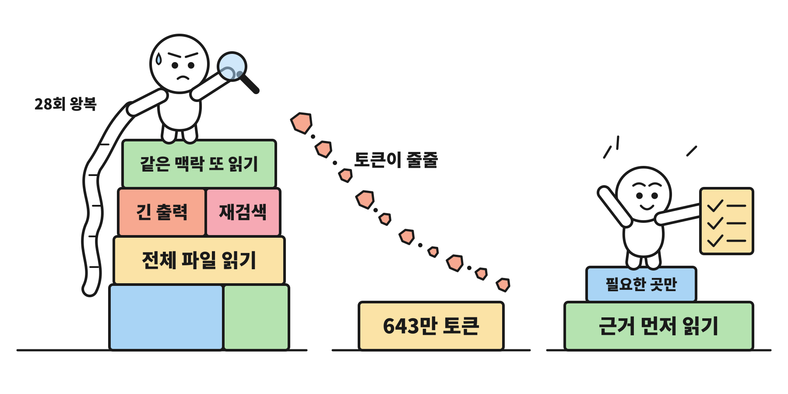
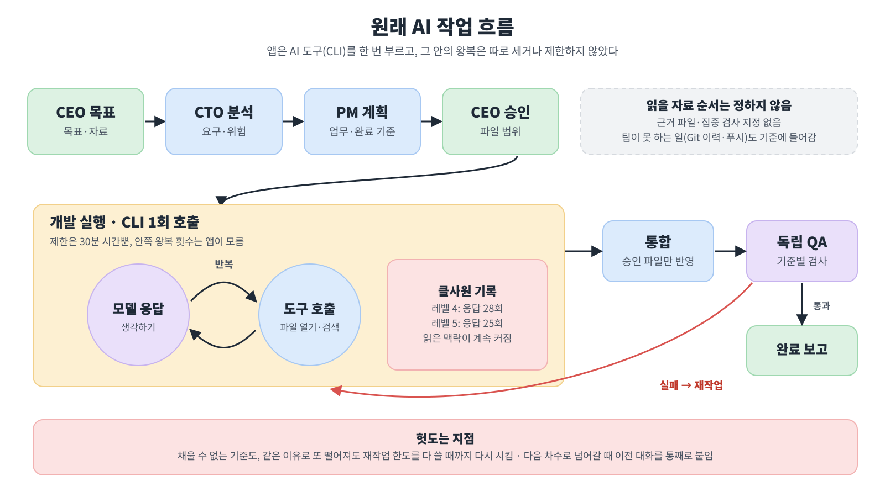
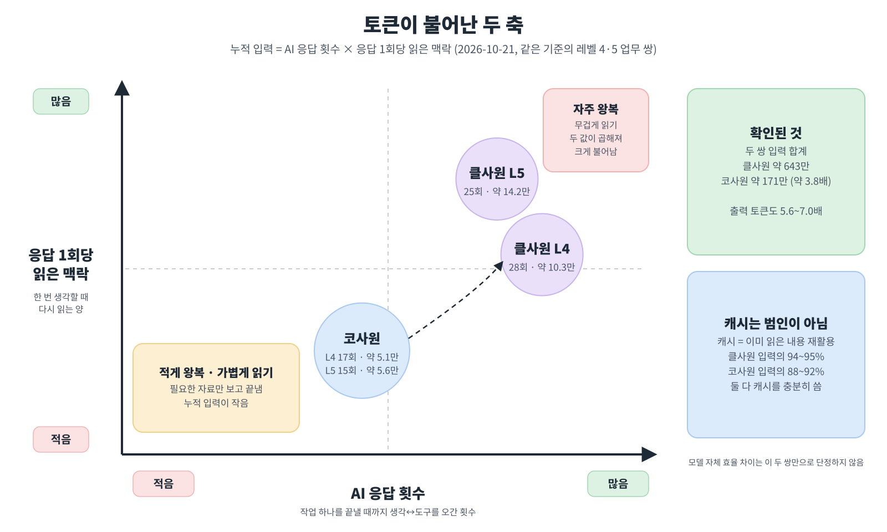
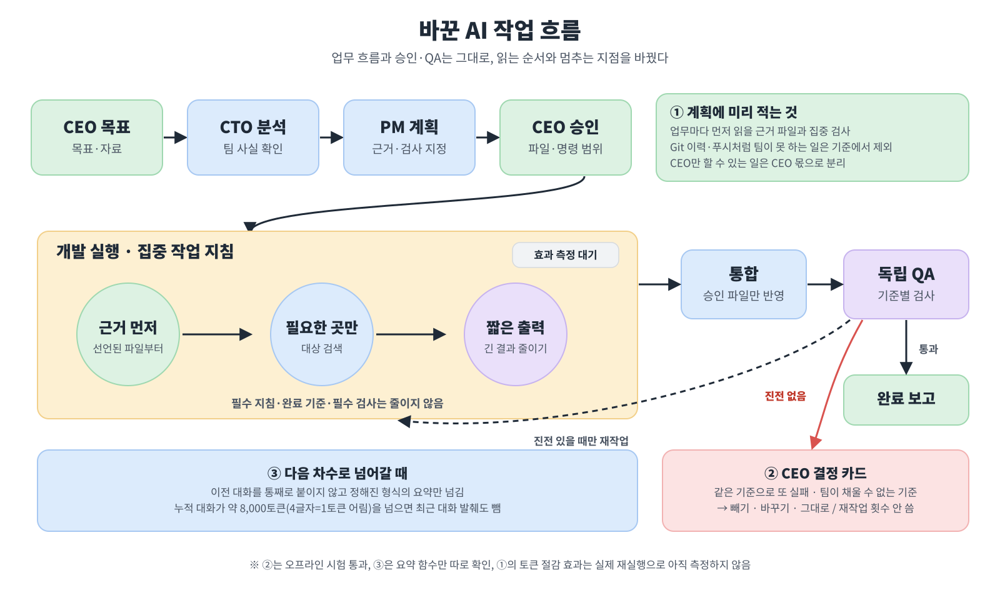

# uCompany 토큰 슈킹범 클사원을 개선했다

같은 일을 시켰는데, 왜 클사원만 영수증이 네 배 가까이 나올까.

uCompany는 목표를 주면 AI 팀원들이 나눠서 계획하고, 만들고, 검사하는 앱이다. 개발 팀원 중에는 Claude로 연결한 팀원(이하 클사원)과 Codex로 연결한 팀원(이하 코사원)이 있다. 토큰 사용량 화면을 보다가 클사원 쪽 숫자만 유독 크다는 걸 알게 됐다. 토큰은 AI가 글을 읽고 쓰는 양을 세는 단위라서, 많이 쓸수록 비용과 시간이 늘어난다.

문제는 이 차이가 어디서 생기는지 앱 안에서 잘 보이지 않았다는 점이다. 앱은 AI 도구를 한 번 실행할 뿐이고, 그 안에서 AI가 몇 번 생각하고 몇 개의 파일을 열었는지는 따로 세지 않았다. QA에서 떨어지면 같은 일을 다시 시키는데, 그 재작업이 정말 나아지고 있는지도 알기 어려웠다.

내가 잡은 방향은 두 가지다. 하나는 AI가 처음부터 필요한 자료만 보게 하는 것, 다른 하나는 결과가 바뀌지 않는 재작업을 끊는 것이다.

## 같은 일, 다른 영수증

10월 21일, 완료 기준과 파일 구성이 같은 업무 두 쌍을 골라 비교했다. 레벨 4는 파일 13개, 레벨 5는 파일 15개짜리 구현이다. 한 쪽은 코사원이, 다른 쪽은 클사원이 맡았다.

두 쌍을 합친 입력 토큰은 클사원이 약 643만, 코사원이 약 171만이었다. 약 3.8배 차이다. 시간도 달랐다. 레벨 5에서 코사원은 약 6.9분, 클사원은 약 22.1분이 걸렸다. 레벨 4에서는 클사원의 첫 QA가 실패해 재작업까지 거쳤다.

## 원래 AI 작업 흐름은 이랬다

목표가 들어오면 CTO가 분석하고, PM이 업무를 나누고, CEO인 내가 승인한다. 그다음 개발 팀원이 각자 떨어진 작업 폴더에서 만들고, 앱이 결과를 합친 뒤 QA가 검사한다.

눈여겨볼 곳은 개발 단계 안쪽이다. 앱은 CLI(글자로 명령을 주고받는 실행 프로그램)를 한 번 부르지만, 그 안에서 AI는 '생각하기 → 파일 열기 → 다시 생각하기'를 여러 번 오간다. 앱은 30분 시간 제한만 두었고, 이 왕복 횟수나 읽는 순서는 정해 주지 않았다.

QA 쪽에도 헛도는 길이 있었다. 팀이 채울 수 없는 기준, 예를 들어 없는 Git 이력이나 GitHub 푸시가 기준에 들어가면 몇 번을 고쳐도 같은 이유로 떨어졌다. 그래도 엔진은 재작업 횟수를 다 쓸 때까지 다시 시켰다.

## 범인은 캐시가 아니었다

처음엔 캐시를 의심했다. 캐시는 AI가 이미 읽은 내용을 다시 쓸 때 재활용하는 저장분이다. 하지만 기록을 보면 클사원은 입력의 94~95%, 코사원도 88~92%가 캐시였다. 캐시를 못 써서 많이 쓴 게 아니다. 같은 맥락을 더 자주, 더 크게 다시 읽었다는 뜻이다.

숫자를 나눠 보면 이유가 보인다. 레벨 4에서 코사원은 AI 응답 17번에 한 번 평균 약 5.1만 토큰을 읽었고, 클사원은 28번에 약 10.3만 토큰을 읽었다. 레벨 5도 15번·약 5.6만 대 25번·약 14.2만이었다. 누적 입력은 '응답 횟수 × 한 번에 읽는 양'이라서, 두 값이 함께 크면 곱절로 불어난다.

다만 이 두 쌍만으로 모델 자체가 비효율적이라고 단정할 수는 없다. 조사 순서, 도구 쓰는 습관, 맥락 정리 방식 가운데 무엇이 원인인지는 아직 가려내지 못했다.

## 이렇게 바꿨다

첫째, PM이 업무마다 먼저 읽을 근거 파일과 확인할 검사를 지시문에 적는다. 클사원은 그 근거부터 읽고, 프로젝트 전체를 반복해서 검색하는 대신 필요한 곳만 찾고 짧은 결과를 쓴다. 단, 필수 지침과 완료 기준, 필수 검사는 줄일 수 없게 했다. 토큰을 아끼려고 품질을 깎으면 개선이라고 할 수 없다.

둘째, 헛도는 재작업을 끊었다. 직전과 같은 기준으로 또 떨어지거나 팀이 채울 수 없는 기준이면, 재작업 대신 CEO 결정 카드가 뜬다. 나는 그 기준을 빼거나, 바꾸거나, 그대로 둘 수 있고, 이때는 재작업 횟수를 쓰지 않는다.

셋째, 같은 대화에서 다음 차수로 넘어갈 때 이전 대화를 통째로 붙이지 않는다. 정해진 형식의 요약만 넘기고, 누적 대화가 약 8,000토큰(4글자를 1토큰으로 어림)을 넘으면 최근 대화 발췌도 뺀다.

## 아직 다듬어야 할 것

첫째 개선의 효과는 아직 재 보지 않았다. 바뀐 지침으로 같은 레벨 4·5 업무를 클사원에게 다시 맡겨, 토큰과 시간, 첫 QA 결과를 이전 기록과 나란히 놓아 봐야 한다. 지침은 권고라서 AI가 실제로 따랐는지도 확인해야 한다.

반대로 토큰이 줄어도 첫 QA 결과가 나빠지면 개선으로 보지 않기로 했다. 숫자만 작아진 영수증은 의미가 없다.

## 정리

이번 일로 배운 건, 토큰이 많이 나온 이유를 '모델이 비싸서'가 아니라 '몇 번 오갔고 한 번에 얼마나 읽었나'로 나눠 봐야 한다는 점이다. 앞으로 기준으로 삼을 질문은 이 팀원이 꼭 필요한 것만 읽었는지, 같은 실패를 되풀이하지 않았는지다. 내가 만들고 싶은 건 AI가 어디서 시간을 쓰는지 CEO가 한눈에 보고, 헛도는 순간 바로 결정할 수 있는 회사다.

**한 줄 요약: 클사원은 슈킹범이 아니었다. 길을 안 알려 준 회사가 문제였다.**
